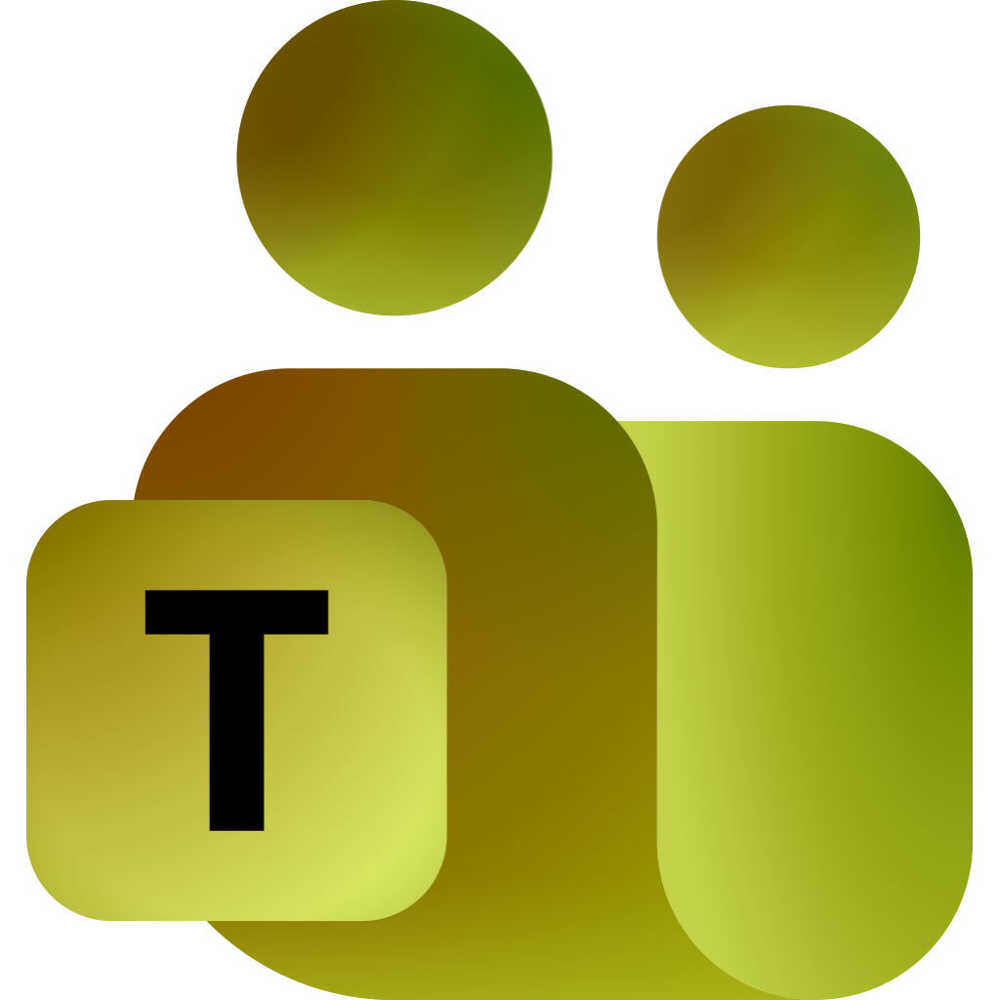

<p align="center">
  
</p>

<h1 align="center">Unteams</h1>

<p align="center">
  <a href="https://testflight.apple.com/join/ErDrUXW4"></a>
  <a href="https://github.com/devxoul/unteams/releases/latest"></a>
</p>

A personal Microsoft Teams wrapper for macOS and iOS. It loads [Teams on the web](https://teams.cloud.microsoft), which doesn't require the device registration that the official enterprise apps enforce, and adds what a browser tab lacks.

## Why

Many organizations only let the official Teams apps in through device management (Intune or Company Portal). Teams on the web works without that, but it's a tab: it gets lost among others, it can't put a badge on the Dock, and its notifications depend on the browser. Unteams turns the web app into a standalone app and changes nothing else.

## Features

### Mac

- A Dock app with its own window and menu bar.
- No title bar: Teams' top bar takes its place. Drag its empty space to move the window, and double-click it to zoom.
- Native notifications through Notification Center. Clicking one brings the window back.
- An unread badge on the Dock icon.
- Closing the window only hides it, so Teams keeps running and notifications keep arriving. Click the Dock icon to bring it back.

### iOS and iPadOS

- The Teams web app in full screen, shown as desktop Safari so Teams doesn't turn it away as an unsupported mobile browser.
- You sign in once and stay signed in.
- No notifications: iOS suspends WKWebView in the background, so the page can't receive them.

### Both

- Teams and Microsoft sign-in pages, including your company's own SSO host, stay in the app.
- Links to other sites, `mailto:`, and `tel:` open in the default browser or app.
- `msteams:` links, which would hand off to the desktop client, are dropped.
- Sign-in popups, camera, and microphone work, so calls work too.

## Why Electron on the Mac

The Mac app used to be a WKWebView like the iOS one. In Low Power Mode, WebKit limits every page's rendering to about 30 frames per second, and Teams becomes sluggish to hover, type and switch chats in. No WebKit setting or runtime hook gets around it, while Teams in Chromium stays smooth. So the Mac app runs on Electron. iOS has to use WebKit, so it stays a Swift app.

## How it works

### Desktop ([`apps/desktop`](apps/desktop))

- **Routing and badge** are in [`src/teams.ts`](apps/desktop/src/teams.ts): a list of Microsoft domains decides which URLs stay in the app, and the unread count comes from the page title (`(3) Chat | Microsoft Teams`) until the page uses the Badging API.
- **Page bridge** is in [`src/preload.ts`](apps/desktop/src/preload.ts). Chromium shows web notifications natively; the bridge makes clicking one bring back the hidden window, sends `navigator.setAppBadge` to the Dock, and pads Teams' top bar so the window buttons don't cover it.
- **Window dragging.** Marking the top bar as `-webkit-app-region: drag` would swallow clicks on Teams' div-based controls, so the preload script turns presses on the bar's empty space into `drag-start`/`drag-move` messages and [`src/main.ts`](apps/desktop/src/main.ts) moves the window.
- **Browser check.** Teams turns away browsers it doesn't recognize, so the app removes Electron from its user agent and presents as Chrome.

### iOS ([`apps/ios`](apps/ios))

Everything Teams-specific is in [`App/Teams.swift`](apps/ios/App/Teams.swift).

- **Staying signed in.** Teams renews tokens in a hidden `login.microsoftonline.com` iframe. With WebKit's tracking prevention on, that iframe can't see the sign-in cookie, so every renewal fails and Teams asks you to sign in again. Unteams turns tracking prevention off through a private WebKit switch. That's fine for a personal build but rules out the App Store.
- **Browser check.** The user agent includes a Safari version token, and pages load in desktop mode.

## Requirements

- macOS for the desktop app, iOS 18 or later for the iPhone and iPad app
- [Bun](https://bun.sh)
- Xcode 26 and [Tuist](https://tuist.dev) for iOS
- An Apple Developer team for iOS code signing

## Build

Install dependencies once from the repository root:

```sh
bun install
```

### Desktop

```sh
cd apps/desktop
bun run start     # build and run
bun run package   # build Unteams.app into release/
bun run package:debug   # build "Unteams Debug" into release/debug/, with its own app ID and icon
```

### iOS

1. Set your own `teamID` (and optionally `bundleIDPrefix`) in [`apps/ios/Project.swift`](apps/ios/Project.swift).
2. Generate the workspace, open it, and run the `UnteamsiOS` scheme:

   ```sh
   cd apps/ios
   tuist generate
   ```

Each iOS configuration has its own bundle ID and icon, so all three can be installed side by side and told apart.

| Configuration | Bundle ID prefix | Icon            |
| ------------- | ---------------- | --------------- |
| Debug         | `<prefix>.debug` | `AppIcon-Debug` |
| Development   | `<prefix>.dev`   | `AppIcon-Dev`   |
| Production    | `<prefix>`       | `AppIcon`       |

### Checks

From the repository root:

```sh
bun run typecheck   # TypeScript 7
bun run lint        # oxlint
bun run format      # oxfmt
```

## Project layout

```
apps/desktop/          Electron app for macOS (TypeScript)
  src/main.ts          Window, menu, Dock badge, link routing, permissions
  src/preload.ts       Bridge script injected into the Teams page
  src/teams.ts         Teams URL, Microsoft domains, routing, unread count
apps/ios/              iOS app (Swift, Tuist)
  Project.swift        Tuist project: target, bundle IDs, signing, configurations
  App/                 SwiftUI entry point, web view, Teams configuration
  Resources/           App icons for each configuration (also used by the desktop app)
```

## Limitations

- It's the Teams web app, so it has the web app's features and nothing more.
- No notifications on iOS (see above).
- The iOS app uses private WebKit API, so it isn't meant for the App Store.
- Not affiliated with Microsoft.
